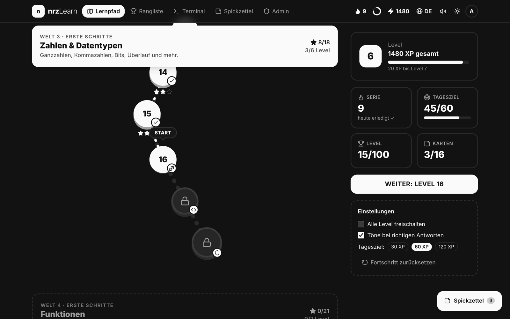
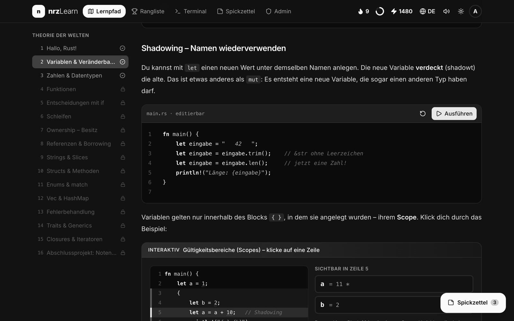
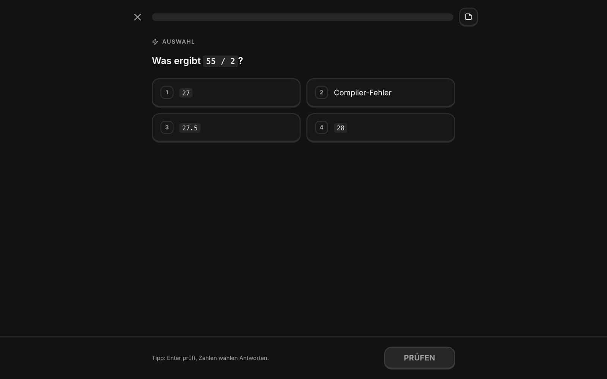
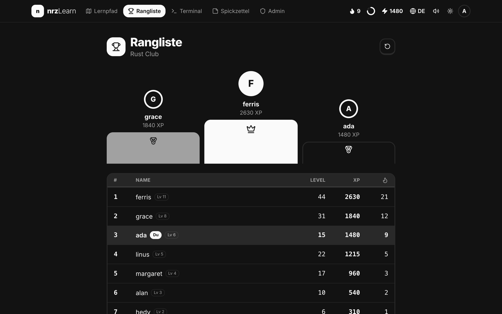
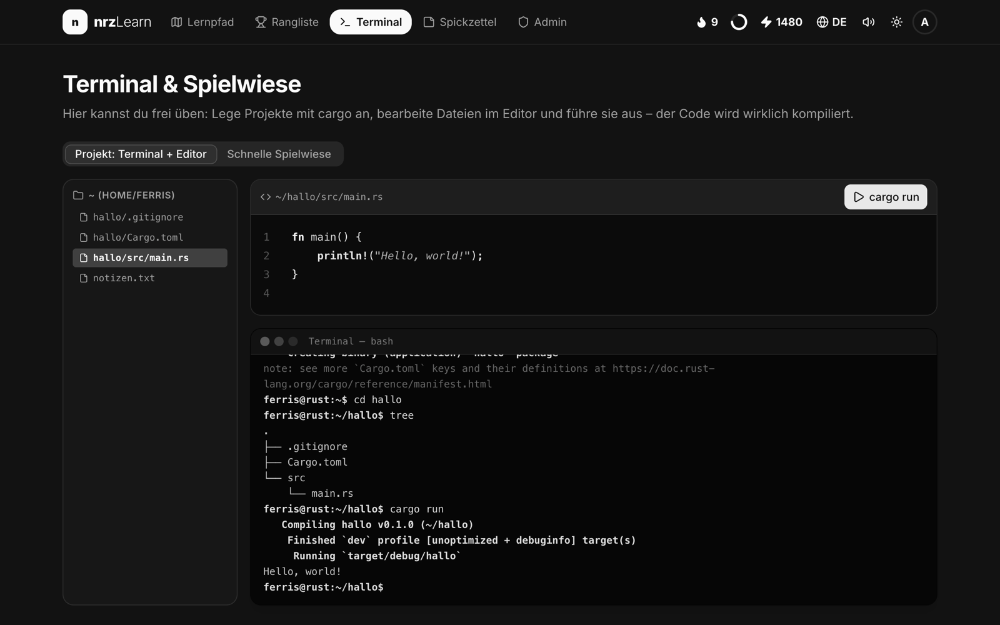
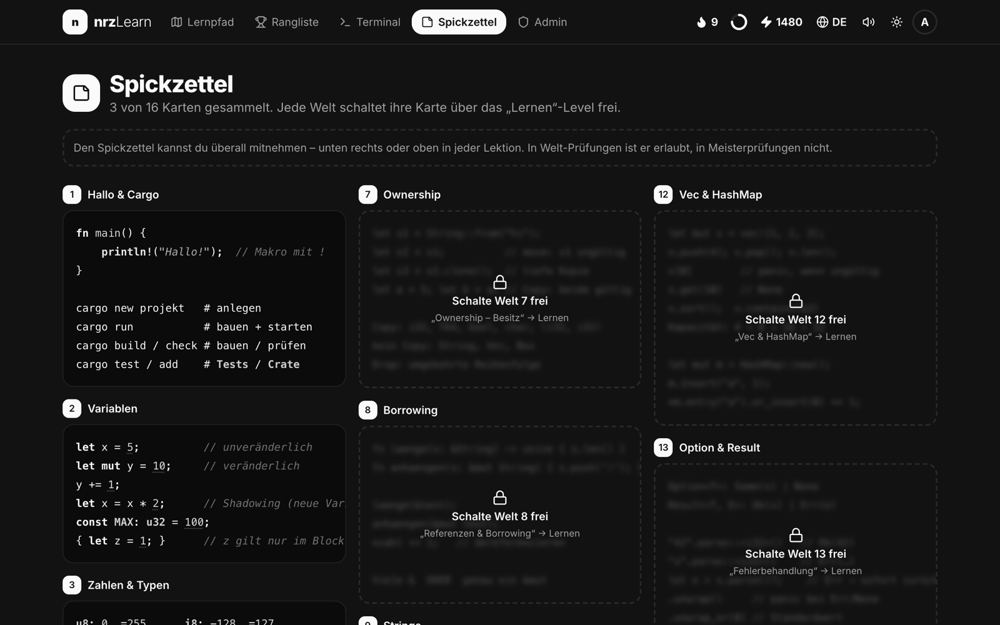
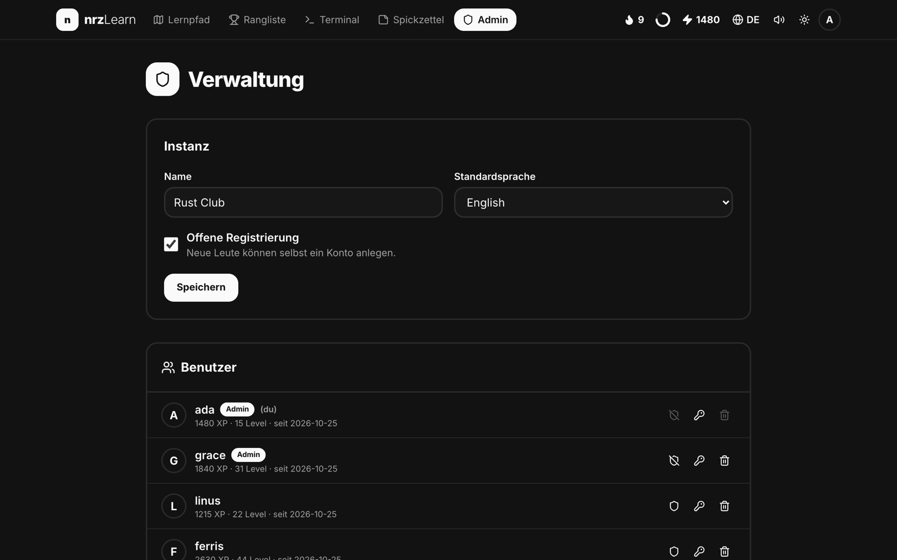
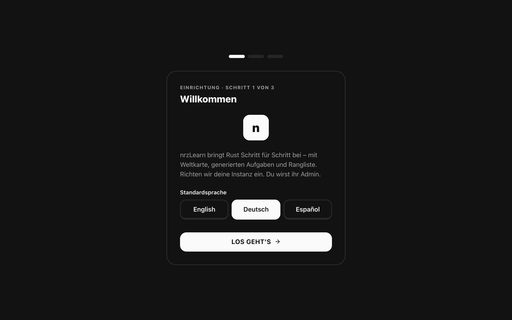
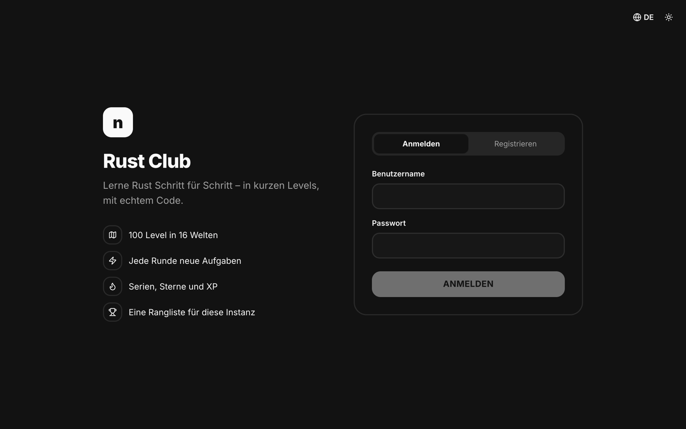

<div align="center">

# nrzLearn

**Rust Schritt für Schritt lernen: selbst gehostet, für viele Nutzer, mit Weltkarte, generierten Aufgaben und Rangliste.**

[English](README.md) · **Deutsch** · [Español](README.es.md)



</div>

nrzLearn ist eine Web-App, mit der du Rust von Grund auf lernst, inspiriert von Duolingo. Du gehst durch 100 kurze Level in 16 Welten: Theorie mit interaktiven Grafiken, Übungsrunden, die jedes Mal neu generiert werden, Labore mit echtem Code und Prüfungen. Auf einer Instanz kann sich jeder registrieren und auf einer gemeinsamen Rangliste mitmachen.

Alles ist in Rust geschrieben: Das Frontend ist [Dioxus](https://dioxuslabs.com), kompiliert zu WebAssembly, mit Komponenten von [rust-ui](https://github.com/rust-ui/ui), und das Backend ist [axum](https://github.com/tokio-rs/axum) mit SQLite.

## Funktionen

- **Weltkarte**: 16 Welten und 100 Level, von `println!` bis zu Traits, Closures und Iteratoren. Jede Welt hat ein Theorie-Level, drei Übungsrunden, manchmal ein Labor und eine Prüfung. Jede vierte Welt endet mit einer Meisterprüfung.
- **Generierte Aufgaben**: viele Aufgabentypen (Auswahl, Lückentext, Zeilen ordnen, Code aus Bausteinen bauen, Fehler finden, Paare zuordnen, rechnen, echten Code schreiben, Terminal-Aufgaben). Jede Runde ist anders, und die Lösungen werden mit echtem Rust berechnet.
- **Interaktive Grafiken**: Stack und Heap Schritt für Schritt, Ownership und Borrowing, Bitmuster, ein wachsender `Vec`, Match-Muster, Iterator-Ketten und mehr.
- **Echter Code**: Codebeispiele und Code-Aufgaben werden auf dem offiziellen Rust Playground kompiliert und ausgeführt.
- **Simuliertes Terminal**: `cargo new`, `cd`, `tree`, `cat`, ein kleiner Editor und `cargo run`.
- **Dopamin inklusive**: XP, Stufen, Sterne, Serien, ein Tagesziel, Herzen in Prüfungen, Konfetti und Töne.
- **Spickzettel**: Jede Welt schaltet eine Karte frei. In Weltprüfungen darfst du ihn öffnen, in Meisterprüfungen nicht.
- **Konten und Rangliste**: Registrierung (offen oder geschlossen), Anmeldung, Fortschritt auf dem Server und eine Rangliste pro Instanz.
- **Onboarding für den Admin**: Beim ersten Start richtet ein Assistent den Namen der Instanz, die Standardsprache, die Registrierung und das Admin-Konto ein.
- **Admin-Bereich**: Instanz umbenennen, Registrierung öffnen oder schließen, Admins ernennen, Passwörter zurücksetzen und Benutzer löschen.
- **Drei Sprachen**: Englisch (Standard), Deutsch und Spanisch, komplett übersetzt, inklusive aller Lektionen und generierten Aufgaben.
- **Design in Grautönen** mit hellem und dunklem Modus.

## Screenshots

| | |
|---|---|
|  **Lektionen** mit interaktiven Grafiken |  **Aufgaben**, jede Runde neu generiert |
|  **Rangliste** der Instanz |  **Terminal** und Editor |
|  **Spickzettel**-Karten |  **Admin-Bereich** |
|  **Onboarding** beim ersten Start |  **Anmeldung und Registrierung** |

## Schnellstart mit Docker

```bash
docker run -d --name nrzlearn -p 8080:8080 -v nrzlearn-data:/data ghcr.io/nicorenezweers/nrzlearn:latest
```

Öffne <http://localhost:8080>. Beim ersten Aufruf startet das Onboarding, in dem du das Admin-Konto anlegst.

Oder mit Docker Compose (siehe [`docker-compose.yml`](docker-compose.yml)):

```bash
docker compose up -d
```

Das Image gibt es für `linux/amd64` und `linux/arm64`. Selbst bauen:

```bash
docker build -t nrzlearn .
```

### Konfiguration

| Variable | Standard (Docker) | Beschreibung |
|---|---|---|
| `NRZLEARN_ADDR` | `0.0.0.0:8080` | Adresse, auf der der Server lauscht |
| `NRZLEARN_DATA` | `/data` | Verzeichnis für die SQLite-Datenbank |
| `NRZLEARN_PUBLIC` | `/app/public` | Verzeichnis mit der gebauten Web-App |
| `NRZLEARN_SECURE_COOKIES` | nicht gesetzt | Auf `true` setzen, wenn nrzLearn über HTTPS läuft |

Alle Daten (Benutzer, Fortschritt, Einstellungen) liegen in einer einzigen SQLite-Datei in `/data`. Sichere dieses Volume.

Wenn nrzLearn aus dem Internet erreichbar ist, stell es hinter einen Reverse Proxy mit HTTPS (Caddy, Traefik, nginx…) und setze `NRZLEARN_SECURE_COOKIES=true`.

### Datenschutz

Passwörter werden mit Argon2 gehasht, Sitzungen nutzen zufällige Tokens in HttpOnly-Cookies. Wenn jemand auf **Ausführen** drückt, wird der Code zum Kompilieren an den offiziellen Rust Playground (`play.rust-lang.org`) geschickt. Sonst verlässt nichts deinen Server.

## Entwicklung

Voraussetzungen: Rust (stable) mit dem Target `wasm32-unknown-unknown` und die [Dioxus CLI](https://dioxuslabs.com/learn/0.7/getting_started) 0.7.10.

```bash
rustup target add wasm32-unknown-unknown
cargo install dioxus-cli --version 0.7.10 --locked
./dev.sh
```

`dev.sh` startet den API-Server auf Port 8090 und den Dioxus-Entwicklungsserver auf <http://localhost:8091>, der `/api` an den Server weiterleitet. Tailwind CSS baut `dx` automatisch.

```bash
cargo test --workspace                     # Aufgaben-Generatoren und Übersetzungen
dx bundle --platform web --release         # Produktions-Build der Web-App
cargo build --release -p nrzlearn-server   # Produktions-Server
```

### Projektstruktur

```
src/            Web-App (Dioxus, WebAssembly)
  content/      Lektionen auf Englisch, Deutsch und Spanisch
  aufgaben/     Aufgaben-Generatoren
  visuals/      Interaktive Grafiken
  pages/        Seiten: Lernpfad, Lektion, Spieler, Rangliste, Admin, Onboarding…
  i18n.rs       Sprachen und das tr!-Makro
server/         Backend (axum, SQLite): Konten, Fortschritt, Rangliste, Admin
shared/         Typen, die Web-App und Server teilen
```

### Eine Sprache hinzufügen

Texte nutzen das Makro `tr!(sprache, en, de, es)`. Eine neue Sprache braucht eine neue Variante in `Sprache` (`src/i18n.rs`), ein weiteres Argument in jedem `tr!` und eine übersetzte Lektionsdatei in `src/content/`. Der Test `sprachen_haben_gleiche_struktur` prüft, dass generierte Aufgaben in jeder Sprache dieselbe Struktur haben.
