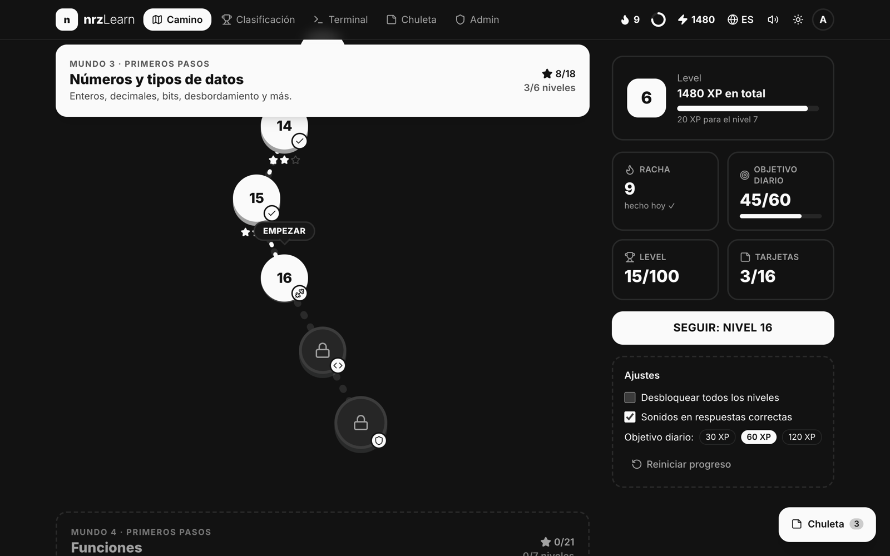
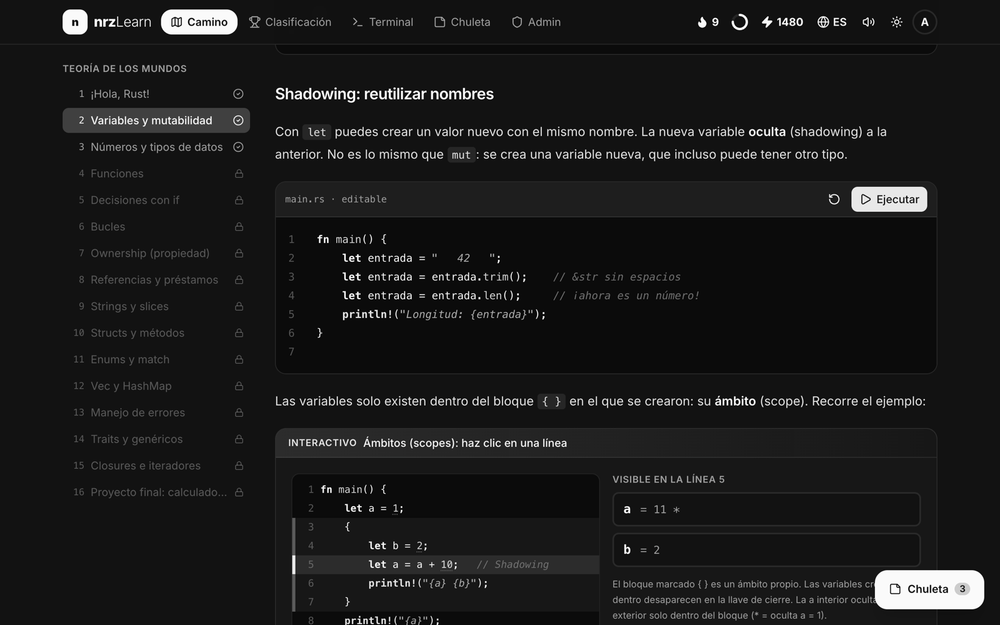
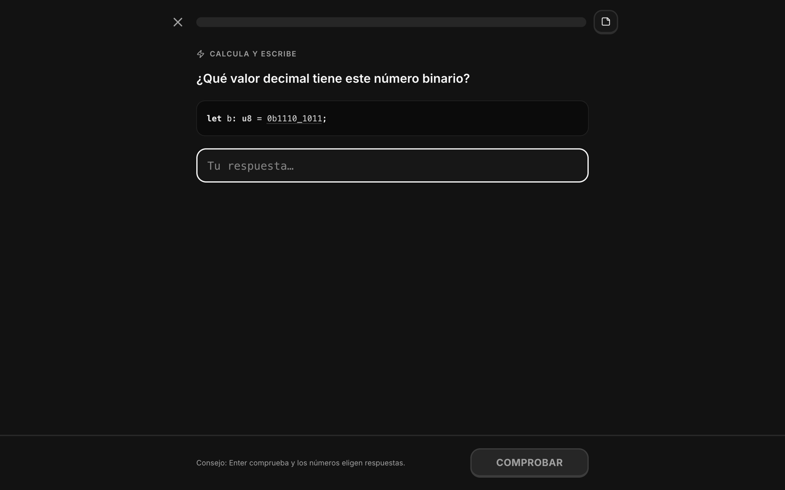
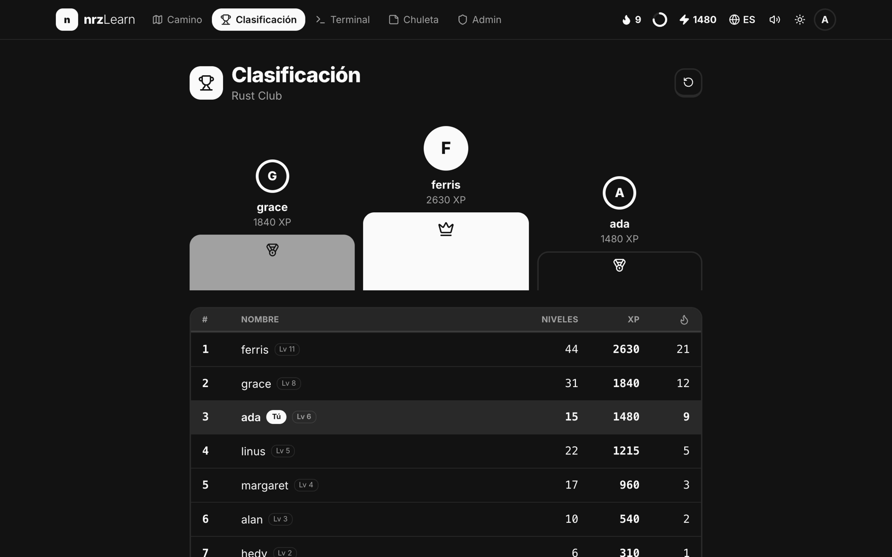
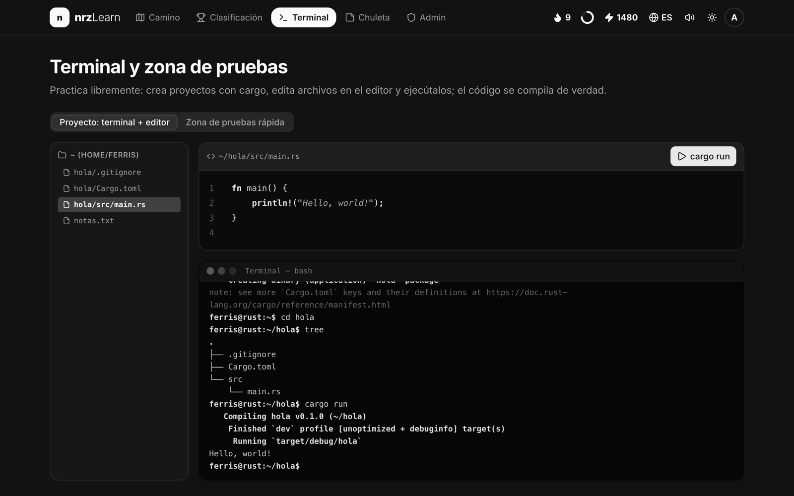
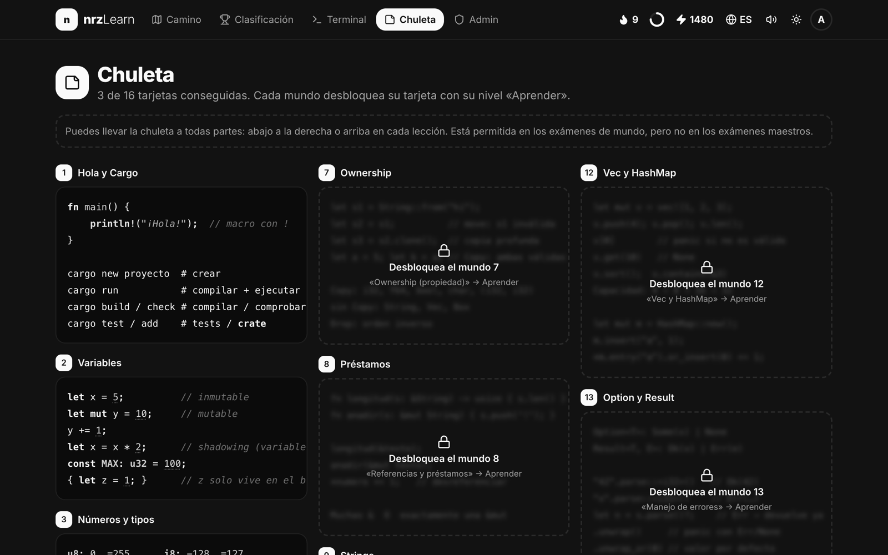
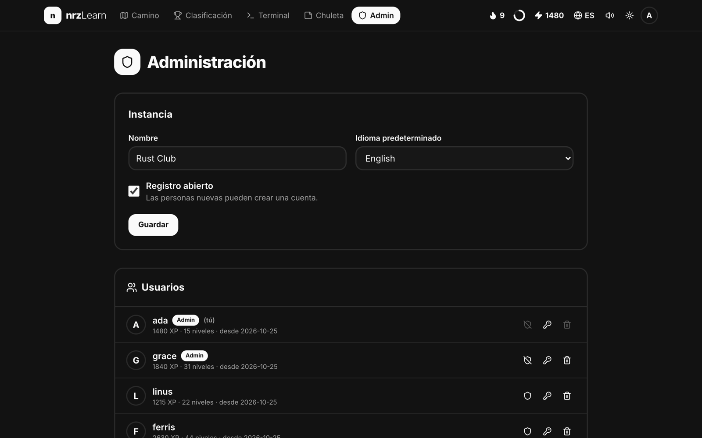
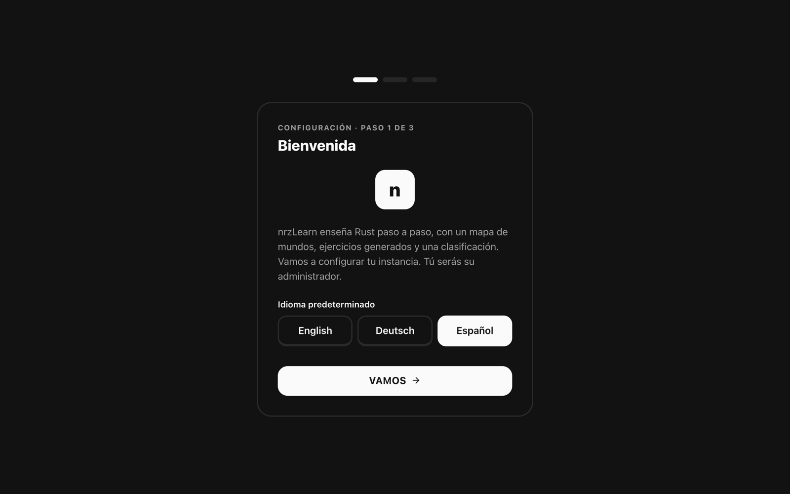
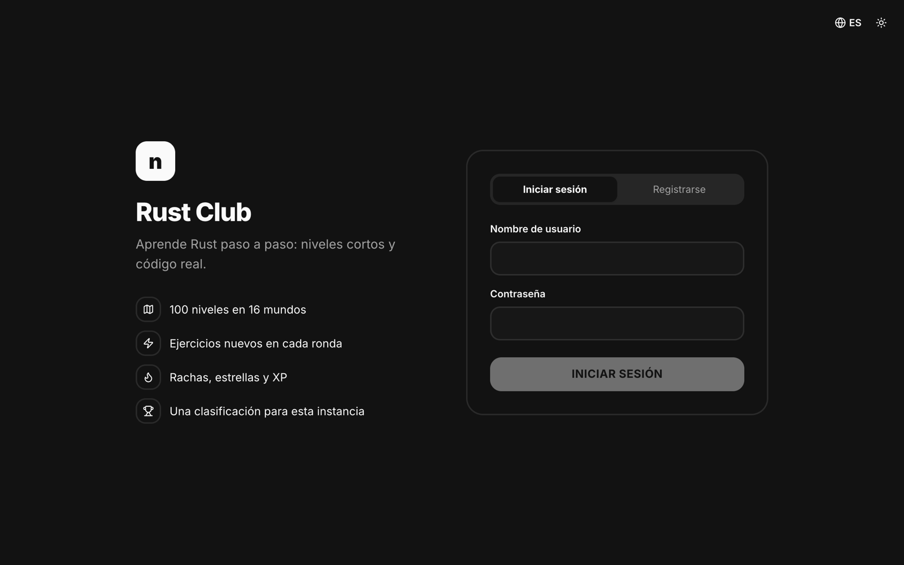

<div align="center">

# nrzLearn

**Aprende Rust paso a paso: autoalojado, multiusuario, con mapa de mundos, ejercicios generados y clasificación.**

[English](README.md) · [Deutsch](README.de.md) · **Español**



</div>

nrzLearn es una aplicación web para aprender Rust desde cero, inspirada en Duolingo. Recorres 100 niveles cortos en 16 mundos: teoría con visualizaciones interactivas, rondas de ejercicios que se generan de nuevo cada vez, laboratorios con código real y exámenes. Todos en una instancia pueden registrarse y competir en una clasificación común.

Todo está escrito en Rust: el frontend es [Dioxus](https://dioxuslabs.com) compilado a WebAssembly, con componentes de [rust-ui](https://github.com/rust-ui/ui), y el backend es [axum](https://github.com/tokio-rs/axum) con SQLite.

## Funciones

- **Mapa de mundos**: 16 mundos y 100 niveles, desde `println!` hasta traits, closures e iteradores. Cada mundo tiene un nivel de teoría, tres rondas de ejercicios, a veces un laboratorio y un examen. Cada cuarto mundo termina con un examen maestro.
- **Ejercicios generados**: muchos tipos de ejercicio (opción múltiple, rellenar huecos, ordenar líneas, construir código con bloques, encontrar el error, emparejar, calcular, escribir código real, tareas de terminal). Cada ronda es distinta y las respuestas se calculan con Rust real.
- **Visualizaciones interactivas**: pila y montón paso a paso, ownership y préstamos, patrones de bits, un `Vec` que crece, patrones de match, cadenas de iteradores y más.
- **Código real**: los ejemplos y ejercicios de código se compilan y ejecutan en el Rust Playground oficial.
- **Terminal simulado**: `cargo new`, `cd`, `tree`, `cat`, un pequeño editor y `cargo run`.
- **Dopamina incluida**: XP, niveles, estrellas, rachas, una meta diaria, vidas en los exámenes, confeti y sonidos.
- **Chuleta**: cada mundo desbloquea una tarjeta. Puedes abrirla en los exámenes de mundo, pero no en los exámenes maestros.
- **Cuentas y clasificación**: registro (abierto o cerrado), inicio de sesión, progreso guardado en el servidor y una clasificación por instancia.
- **Configuración inicial para el administrador**: en el primer arranque, un asistente configura el nombre de la instancia, el idioma predeterminado, el registro y la cuenta de administrador.
- **Área de administración**: renombrar la instancia, abrir o cerrar el registro, nombrar administradores, restablecer contraseñas y eliminar usuarios.
- **Tres idiomas**: inglés (predeterminado), alemán y español, traducidos por completo, incluidas todas las lecciones y los ejercicios generados.
- **Diseño en escala de grises** con modo claro y oscuro.

## Capturas de pantalla

| | |
|---|---|
|  **Lecciones** con visualizaciones interactivas |  **Ejercicios** generados en cada ronda |
|  **Clasificación** de la instancia |  **Terminal** y editor |
|  Tarjetas de la **chuleta** |  **Área de administración** |
|  **Configuración inicial** |  **Inicio de sesión y registro** |

## Inicio rápido con Docker

```bash
docker run -d --name nrzlearn -p 8080:8080 -v nrzlearn-data:/data ghcr.io/nicorenezweers/nrzlearn:latest
```

Abre <http://localhost:8080>. La primera visita inicia la configuración, donde creas la cuenta de administrador.

O con Docker Compose (ver [`docker-compose.yml`](docker-compose.yml)):

```bash
docker compose up -d
```

La imagen está disponible para `linux/amd64` y `linux/arm64`. Para construirla tú mismo:

```bash
docker build -t nrzlearn .
```

### Configuración

| Variable | Valor por defecto (Docker) | Descripción |
|---|---|---|
| `NRZLEARN_ADDR` | `0.0.0.0:8080` | Dirección en la que escucha el servidor |
| `NRZLEARN_DATA` | `/data` | Directorio de la base de datos SQLite |
| `NRZLEARN_PUBLIC` | `/app/public` | Directorio con la aplicación web compilada |
| `NRZLEARN_SECURE_COOKIES` | sin definir | Ponlo en `true` cuando nrzLearn se sirva por HTTPS |

Todos los datos (usuarios, progreso, ajustes) están en un único archivo SQLite en `/data`. Haz copias de seguridad de ese volumen.

Si nrzLearn es accesible desde internet, ponlo detrás de un proxy inverso con HTTPS (Caddy, Traefik, nginx…) y define `NRZLEARN_SECURE_COOKIES=true`.

### Privacidad

Las contraseñas se guardan con hash Argon2 y las sesiones usan tokens aleatorios en cookies HttpOnly. Cuando alguien pulsa **Ejecutar**, el código se envía al Rust Playground oficial (`play.rust-lang.org`) para compilarlo. Nada más sale de tu servidor.

## Desarrollo

Requisitos: Rust (stable) con el target `wasm32-unknown-unknown` y la [CLI de Dioxus](https://dioxuslabs.com/learn/0.7/getting_started) 0.7.10.

```bash
rustup target add wasm32-unknown-unknown
cargo install dioxus-cli --version 0.7.10 --locked
./dev.sh
```

`dev.sh` inicia el servidor de la API en el puerto 8090 y el servidor de desarrollo de Dioxus en <http://localhost:8091>, que reenvía `/api` al servidor. `dx` compila Tailwind CSS automáticamente.

```bash
cargo test --workspace                     # generadores de ejercicios y traducciones
dx bundle --platform web --release         # build de producción de la aplicación web
cargo build --release -p nrzlearn-server   # servidor de producción
```

### Estructura del proyecto

```
src/            Aplicación web (Dioxus, WebAssembly)
  content/      Lecciones en inglés, alemán y español
  aufgaben/     Generadores de ejercicios
  visuals/      Visualizaciones interactivas
  pages/        Páginas: camino, lección, reproductor, clasificación, admin, configuración…
  i18n.rs       Idiomas y la macro tr!
server/         Backend (axum, SQLite): cuentas, progreso, clasificación, administración
shared/         Tipos compartidos por la aplicación web y el servidor
```

### Añadir un idioma

Los textos usan la macro `tr!(idioma, en, de, es)`. Un idioma nuevo necesita una variante nueva en `Sprache` (`src/i18n.rs`), un argumento más en cada `tr!` y un archivo de lecciones traducido en `src/content/`. El test `sprachen_haben_gleiche_struktur` comprueba que los ejercicios generados tienen la misma estructura en todos los idiomas.

## Licencia

[MIT](LICENSE)
