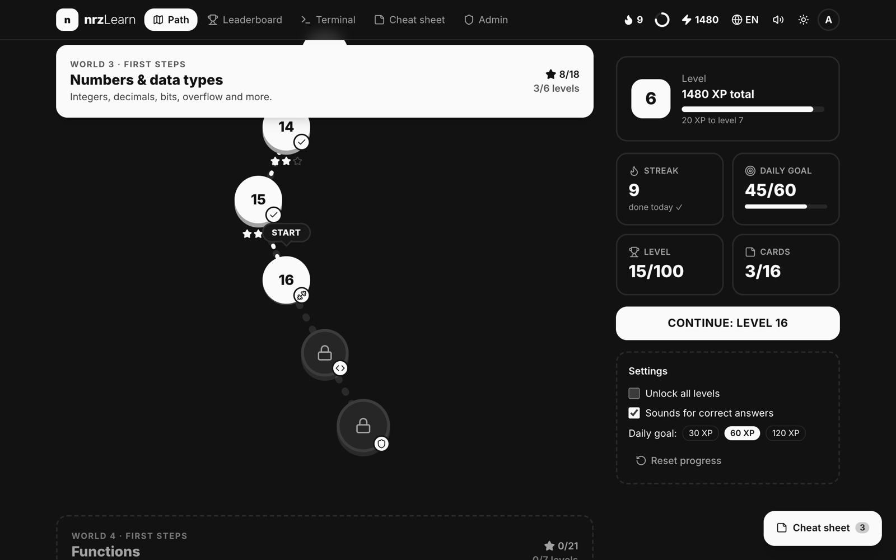
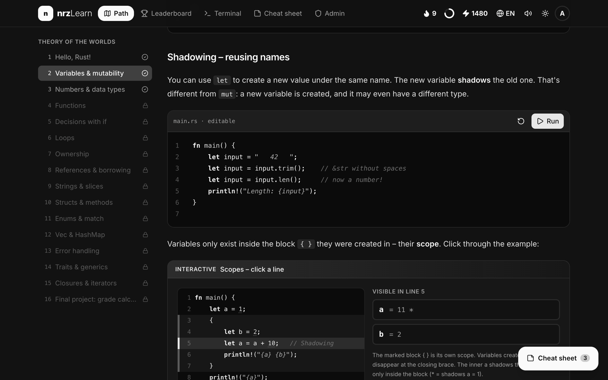
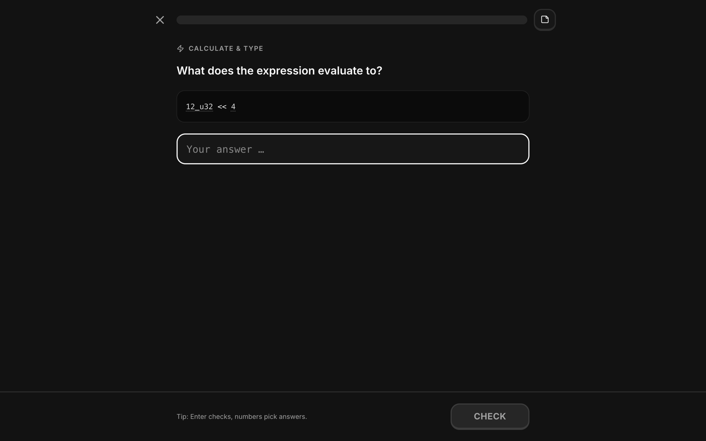
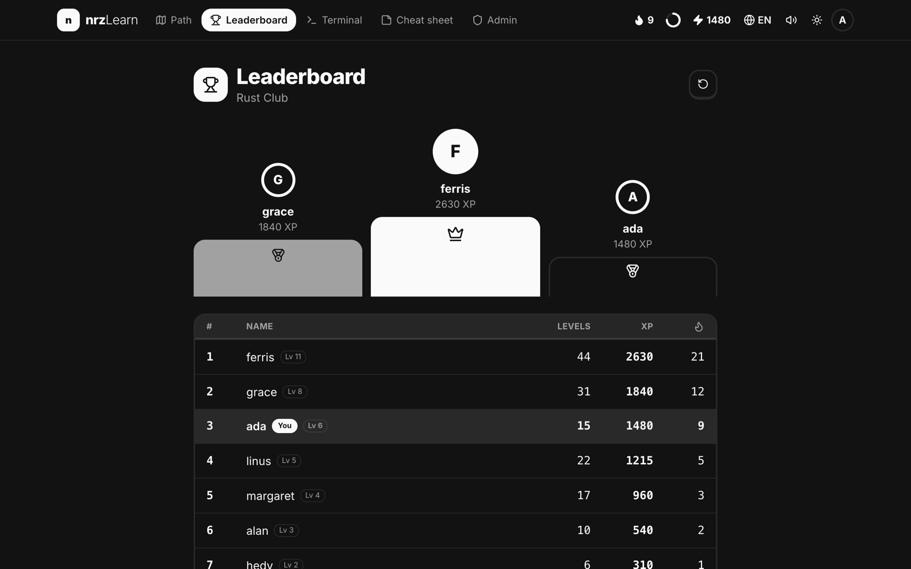
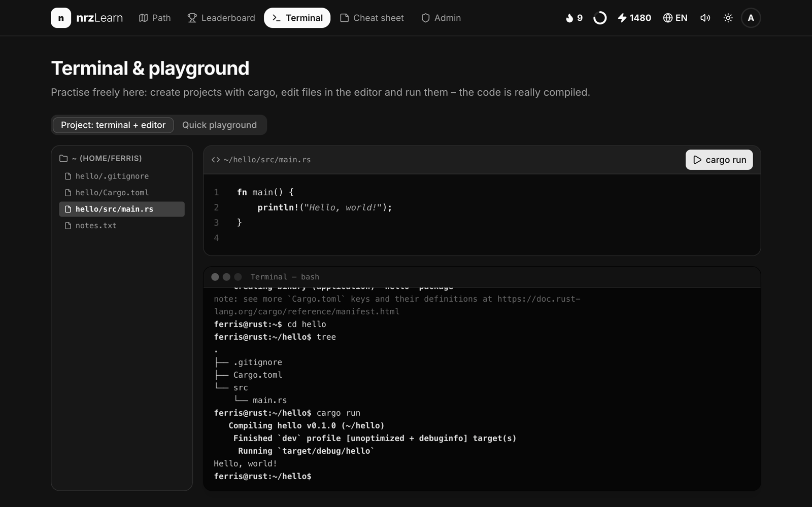
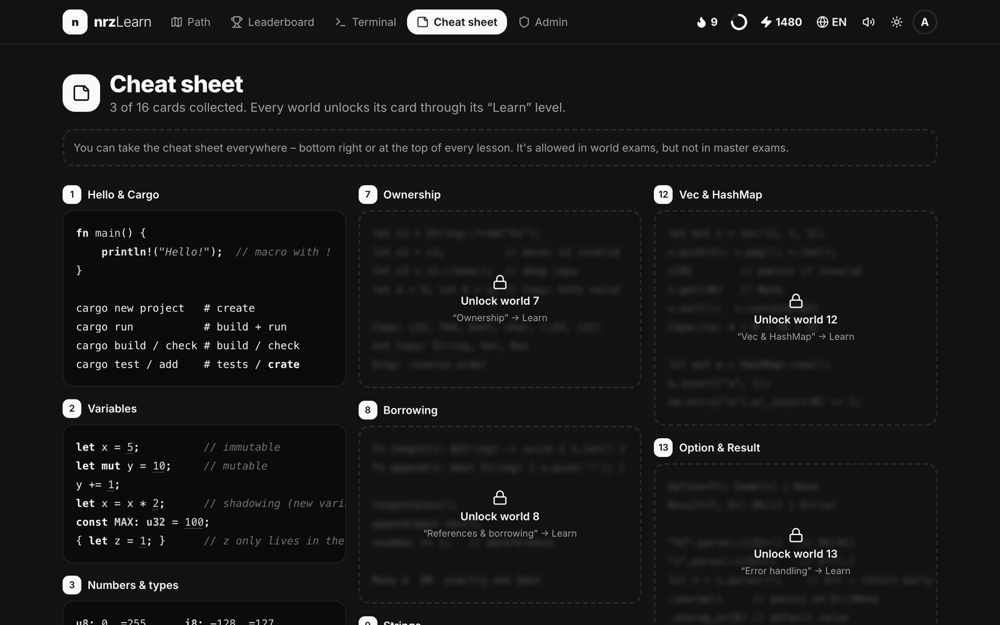
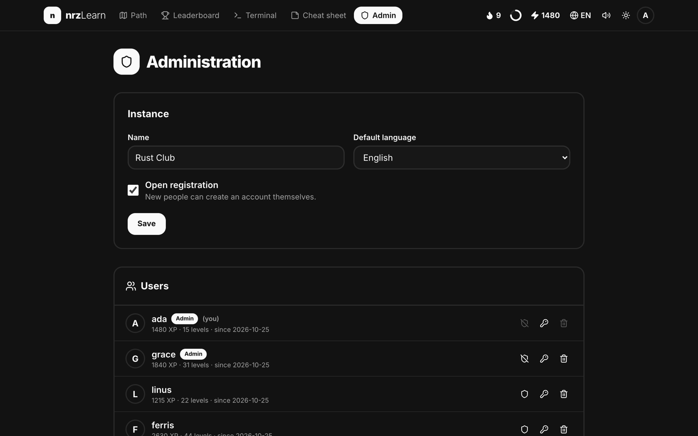
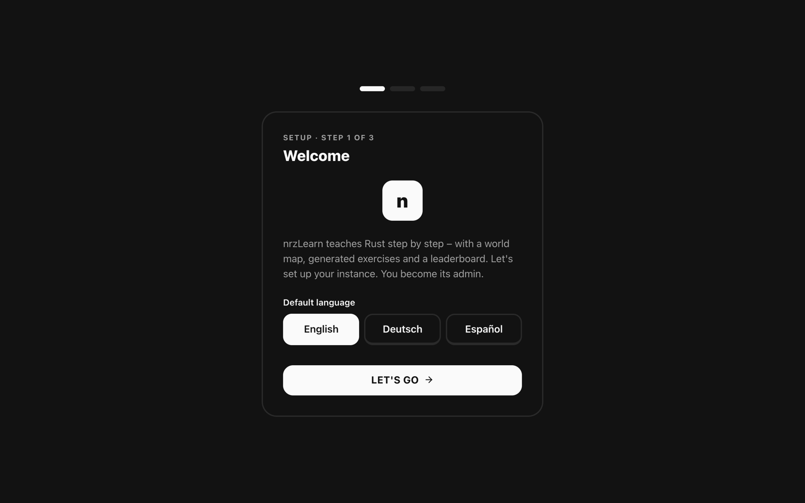
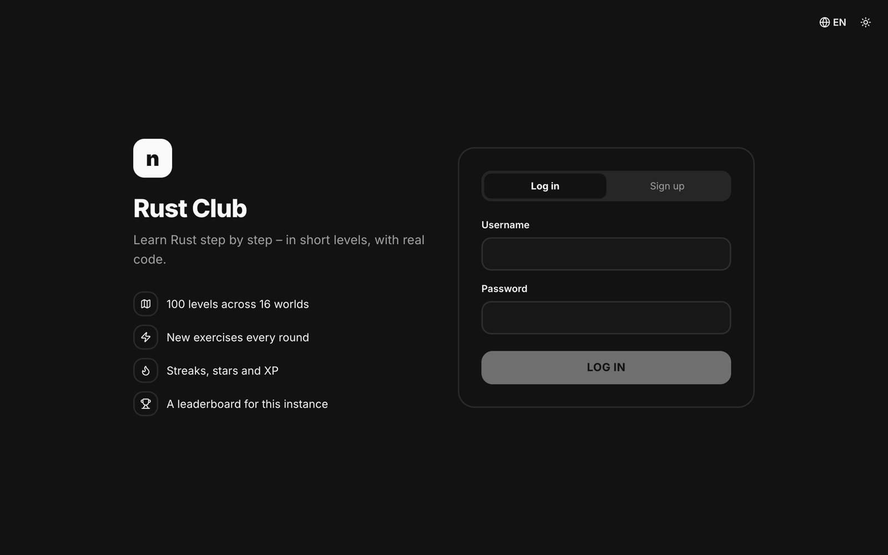
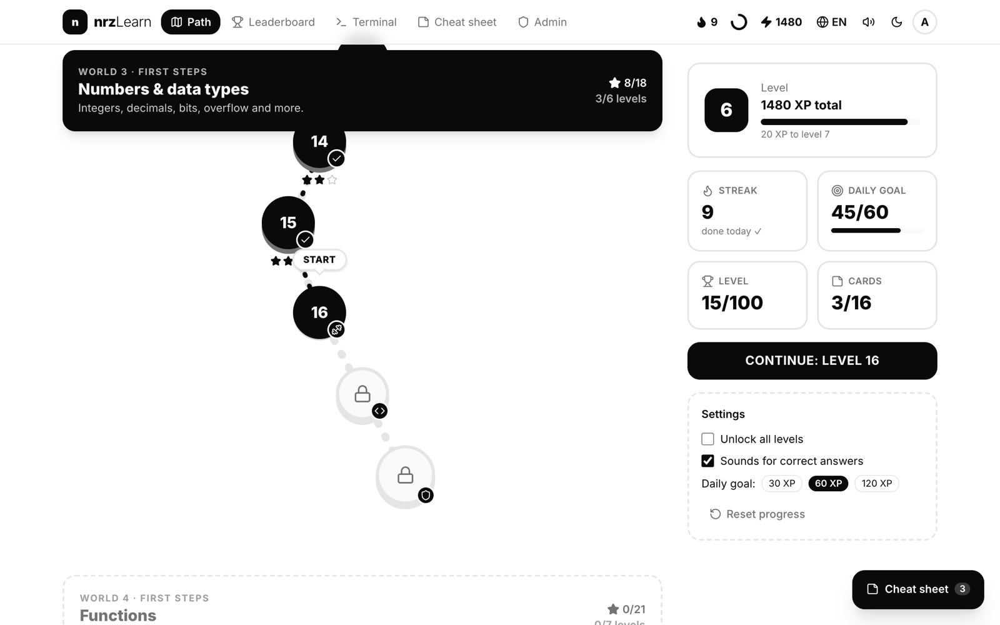

<div align="center">

# nrzLearn

**Rust-powered programming learning platform.**

**English** · [Deutsch](README.de.md) · [Español](README.es.md)



</div>

nrzLearn is a web app for learning Rust from scratch, inspired by Duolingo. You go through 100 short levels in 16 worlds: theory with interactive visuals, exercise rounds that are generated fresh every time, labs with real code, and exams. Everyone on an instance can sign up and compete on a shared leaderboard.

Everything is written in Rust: the frontend is [Dioxus](https://dioxuslabs.com) compiled to WebAssembly, with components from [rust-ui](https://github.com/rust-ui/ui), and the backend is [axum](https://github.com/tokio-rs/axum) with SQLite.

## Features

- **World map**: 16 worlds and 100 levels, from `println!` to traits, closures and iterators. Each world has a theory level, three exercise rounds, sometimes a lab, and an exam. Every fourth world ends with a master exam.
- **Generated exercises**: many exercise types (multiple choice, fill in the blank, order the lines, build code from blocks, spot the bug, match pairs, calculate, write real code, terminal tasks). Each round is different, and the answers are computed with real Rust.
- **Interactive visuals**: stack and heap step by step, ownership and borrowing, bit patterns, a `Vec` growing, match patterns, iterator chains and more.
- **Real code**: code examples and code exercises are compiled and run on the official Rust Playground.
- **Simulated terminal**: `cargo new`, `cd`, `tree`, `cat`, a small editor and `cargo run`.
- **Dopamine included**: XP, levels, stars, streaks, a daily goal, hearts in exams, confetti and sounds.
- **Cheat sheet**: each world unlocks a card. You can open it in world exams, but not in master exams.
- **Accounts and leaderboard**: registration (open or closed), login, progress saved on the server, and a leaderboard per instance.
- **Onboarding for the admin**: on first start, a wizard sets up the instance name, the default language, registration and the admin account.
- **Admin area**: rename the instance, open or close registration, promote admins, reset passwords and delete users.
- **Three languages**: English (default), German and Spanish, fully translated, including all lessons and generated exercises.
- **Grayscale design** with light and dark mode.

## Screenshots

| | |
|---|---|
|  **Lessons** with interactive visuals |  **Exercises**, generated fresh each round |
|  **Leaderboard** for the instance |  **Terminal** and editor |
|  **Cheat sheet** cards |  **Admin area** |
|  **Onboarding** on first start |  **Login and sign-up** |

<details>
<summary>Light mode</summary>



</details>

## Quick start with Docker

```bash
docker run -d --name nrzlearn -p 8080:8080 -v nrzlearn-data:/data ghcr.io/nicorenezweers/nrzlearn:latest
```

Open <http://localhost:8080>. The first visit starts the onboarding, where you create the admin account.

Or with Docker Compose (see [`docker-compose.yml`](docker-compose.yml)):

```bash
docker compose up -d
```

The image is available for `linux/amd64` and `linux/arm64`. To build it yourself:

```bash
docker build -t nrzlearn .
```

### Configuration

| Variable | Default (Docker) | Description |
|---|---|---|
| `NRZLEARN_ADDR` | `0.0.0.0:8080` | Address the server listens on |
| `NRZLEARN_DATA` | `/data` | Directory for the SQLite database |
| `NRZLEARN_PUBLIC` | `/app/public` | Directory with the built web app |
| `NRZLEARN_SECURE_COOKIES` | unset | Set to `true` when nrzLearn is served over HTTPS |

All data (users, progress, settings) lives in a single SQLite file in `/data`. Back up that volume.

Put nrzLearn behind a reverse proxy with HTTPS (Caddy, Traefik, nginx…) when it is reachable from the internet, and set `NRZLEARN_SECURE_COOKIES=true`.

### Privacy

Passwords are hashed with Argon2, and sessions use random tokens in HttpOnly cookies. When a learner presses **Run**, the code is sent to the official Rust Playground (`play.rust-lang.org`) to be compiled. Nothing else leaves your server.

## Development

Requirements: Rust (stable) with the `wasm32-unknown-unknown` target, and the [Dioxus CLI](https://dioxuslabs.com/learn/0.7/getting_started) 0.7.10.

```bash
rustup target add wasm32-unknown-unknown
cargo install dioxus-cli --version 0.7.10 --locked
./dev.sh
```

`dev.sh` starts the API server on port 8090 and the Dioxus dev server on <http://localhost:8091>, which forwards `/api` to the server. Tailwind CSS is built automatically by `dx`.

```bash
cargo test --workspace                     # exercise generators and translations
dx bundle --platform web --release         # production build of the web app
cargo build --release -p nrzlearn-server   # production server
```

### Project structure

```
src/            Web app (Dioxus, WebAssembly)
  content/      Lessons in English, German and Spanish
  aufgaben/     Exercise generators
  visuals/      Interactive visuals
  pages/        Pages: path, lesson, player, leaderboard, admin, onboarding…
  i18n.rs       Languages and the tr! macro
server/         Backend (axum, SQLite): accounts, progress, leaderboard, admin
shared/         Types shared by the web app and the server
```

### Adding a language

Texts use the `tr!(lang, en, de, es)` macro. A new language needs a new variant in `Sprache` (`src/i18n.rs`), one more argument in each `tr!`, and a translated lessons file in `src/content/`. The test `sprachen_haben_gleiche_struktur` checks that generated exercises have the same structure in every language.

## License

[MIT](LICENSE)
